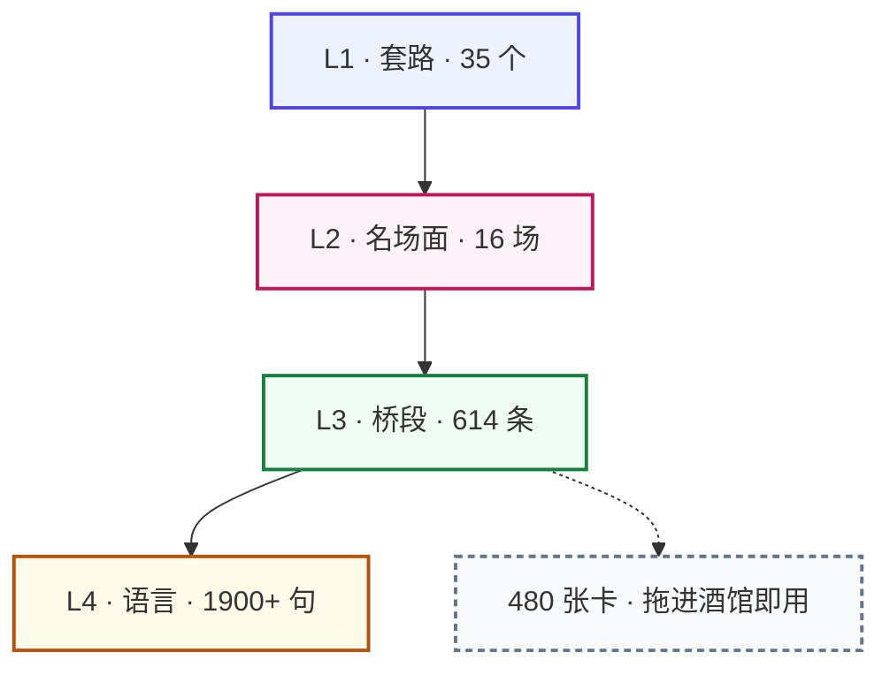

<div align="center">

# 📘 第四爱百科

**Fourth Love Encyclopedia**

一部给中文 GB / 第四爱 / 女尊创作者用的类型研究与创作参考库
既给人读，也给 AI 当创作语料

<br>


<br>

`130.6 万汉字` ｜ `137 篇` ｜ `32,453 行表格` ｜ `零编造`

<br>

[**⚡ 速查入口**](速查入口.md) ·
[📑 全库目录](INDEX.md) ·
[📐 编纂规约](00-编纂规约/) ·
[🧪 去 AI 味工具](11-模板包/去AI味/) ·
[⚖️ 许可](LICENSE.md)

<br>

### 📥 下载后怎么打开

**双击仓库根目录的 `index.html`**

单文件离线百科：全库 133 篇内嵌其中，三栏版式、全文搜索、本页目录，
无需服务器、无外部依赖、断网可用。

</div>

<br>

## 🗺️ 这个库怎么分层

写一场戏，从上往下四层，每层回答不同的问题。



| 层 | 回答什么 | 在哪一卷 |
|---|---|---|
| **L1 · 套路** | 整本书怎么走 | [05-01 经典套路库](05-剧情套路/01-经典套路库.md) |
| **L2 · 名场面** | 这一场对峙怎么落 | [05-02 名场面结构库](05-剧情套路/02-名场面结构库.md) |
| **L3 · 桥段** | 这一场日常戏怎么落 | [14-桥段库](14-桥段库/00-总表.md) |
| **L4 · 语言** | 这一句话怎么说 | [13-02 权力语言库](13-语料挖掘/02-权力语言库.md) |
| **卡** | 让 AI 陪着演 | [11-模板包](11-模板包/) |

> L2 那 16 个场面全是**权力对峙**，一个人知道、另一个不知道，戏就在这儿。
> 日常戏套不进去，它靠的是时间在走。「热了很多遍」就是把时间画出来给读者看。

---

## ⚠️ 阅读须知

<table>
<tr><td width="50%" valign="top">

**内容性质**

中文网络文学某一类型的研究与创作参考资料。

讨论涉及成人向创作，但全部停留在**设定、结构与技法层面**。库内没有成段的情节描写，也没有露骨内容本身。少量露骨词汇只出现在术语词条的定义里，或者讨论平台审查的时候，性质跟任何文学类型研究里的专名一样。全库涉性内容里的角色，一律设定为成年人。

BDSM 与训诫类条目一律附现实共识框架（SSC / RACK / PRICK）与「虚构装置 ≠ 现实指南」的明确区分。

</td><td width="50%" valign="top">

**数据来源**

统计基础是 5,668 篇 / 5.77 亿字的本地私人收藏。

**该收藏不随本库发布。本库不包含也不分发任何作品原文。**

逐条书目清单同样不发布。可公开的聚合统计见 [语料统计](10-藏书索引-公开/语料统计.md)，里面没有书名、作者、文件名。

单部作品引用不超过一句，注明出处就行。社群言论属于研究性短引，量不大。完整论证放在[发布风险评估](00-编纂规约/06-发布风险评估.md)里。

</td></tr>
<tr><td colspan="2">

**支持原创**

> ### 🚫 禁止抄袭！禁止洗稿！
> ### 每个创作者独一无二的作品都值得尊重！

这个类型小，原创作者是它唯一的水源，所以别让搬运和洗稿把水搅浑。你喜欢的作品，去原发平台订阅、正版支持就好。本库只提供模式层：桥段结构、人设原型、世界观规则，这些不属于任何一部作品。但每一部作品的文字、情节编排与人物塑造，版权归它的作者。用本库写你自己的故事，不抄袭，不洗稿。换词改句、挪动情节顺序再发出来，仍然是抄袭。完整条款见 [版权与内容红线 · 第二节](00-编纂规约/03-版权与内容红线.md)。

</td></tr>
</table>

---

## 🚪 三个入口

| 你是谁 | 从哪开始 |
|---|---|
| 初次接触 GB，不知从何下手 | [概念源流与圈史](01-总论/01-概念源流与圈史.md) → [术语使用说明](02-术语百科/00-使用说明.md) → [易混淆词辨析](02-术语百科/05-易混淆词辨析.md) |
| 写到一半卡住了 | [**速查入口**](速查入口.md)：按「卡在哪一步」直接跳，不必先翻目录 |
| 要发文，想知道发哪、怎么标 tag | [平台生态与发文指南](08-平台生态/01-平台生态与发文指南.md)，含三分钟决策树与 19 条避雷清单 |

---

## ⏱️ 五分钟上手

<table>
<tr><td width="33%" valign="top">

### 1️⃣ 只想看
双击 `index.html`

全库 133 篇内嵌，断网可用。
左栏卷目、中间正文、右栏本页目录，
顶上有全文搜索。

</td><td width="33%" valign="top">

### 2️⃣ 要落一场戏
[速查入口](速查入口.md) → 按「卡在哪一步」跳

不知道写什么 → [35 个套路](05-剧情套路/01-经典套路库.md)
知道写什么不知道怎么落 → [614 条桥段](14-桥段库/00-总表.md)
一句话说不对味 → [权力语言库](13-语料挖掘/02-权力语言库.md)

</td><td width="33%" valign="top">

### 3️⃣ 让 AI 陪着写
[11-模板包](11-模板包/) 里拖一张卡进酒馆

480 张全部是 SillyTavern 标准格式，
每张都带去 AI 味约束。
先读一遍 [去AI味/写作预设](11-模板包/去AI味/写作预设.md)。

</td></tr>
</table>

---

## 📚 全库构成

<table>
<tr><th align="left" width="170">卷</th><th align="left">内容</th><th align="right" width="86">规模</th></tr>

<tr><td><a href="00-编纂规约/">00 · 编纂规约</a></td>
<td>分级与预警体系 · 条目模板 · 版权与内容红线 · 质量审计 · 去 AI 化铁律 · 发布风险评估 · 工作流程 · 缺口调研</td>
<td align="right">8 篇</td></tr>

<tr><td><a href="01-总论/">01 · 总论</a></td>
<td>概念源流与圈史 · 英文圈术语对照 · 研究文献 · 英文市场 · 社群画像与 7 组内部争议</td>
<td align="right">5 篇</td></tr>

<tr><td><a href="02-术语百科/">02 · 术语百科</a></td>
<td>核心身份与权力动态 · 女尊称谓与礼制 · 人设与套路标签 · 尺度预警与黑话 · 17 组易混淆辨析 · 速查表</td>
<td align="right">348 条</td></tr>

<tr><td><a href="03-世界观设定/">03 · 世界观设定</a></td>
<td>女尊世界怎么搭 · GB-ABO 设计手册 · 星际、修仙、快穿这些背景怎么选 · 不是女尊的话，权力又从哪来</td>
<td align="right">4 篇</td></tr>

<tr><td><a href="04-人设原型/">04 · 人设原型</a></td>
<td>女主原型 16 型 · 男主原型 20 型 · 配对化学反应矩阵 · 配角功能位</td>
<td align="right">36 型</td></tr>

<tr><td><a href="05-剧情套路/">05 · 剧情套路</a></td>
<td>经典套路 35 个，按市场量级排 · 名场面结构 16 场 · 开篇钩子与节奏 · 关系张力设计</td>
<td align="right">35 套路</td></tr>

<tr><td><a href="06-尺度与写法/">06 · 尺度与写法</a></td>
<td>分级镜头控制 · 清水张力技法 · 情欲场景结构 · 训诫与 BDSM 专论 · 预警与分级实操</td>
<td align="right">5 篇</td></tr>

<tr><td><a href="07-语言风格/">07 · 语言风格</a></td>
<td>女攻叙事语感 · 第二人称写作专论 · 对白与潜台词 · 反 AI 味指南（17 条病） · 常用语汇与句式库</td>
<td align="right">5 篇</td></tr>

<tr><td><a href="08-平台生态/">08 · 平台生态</a></td>
<td>十个平台逐个实测 · tag 体系对照 · 审查红线与发文避雷</td>
<td align="right">1 篇</td></tr>

<tr><td><a href="10-藏书索引-公开/">10 · 语料统计</a></td>
<td>去标识化的聚合分布，无书名、作者、文件名</td>
<td align="right">1 篇</td></tr>

<tr><td><a href="11-模板包/">11 · 模板包</a></td>
<td>角色卡 36 张，两个扮演方向 19:17。情景开局卡 608 张，两方向 224:214，覆盖桥段库全部 44 族。另外还有世界书包 5 个、开场白库、状态板设计，以及预设与正则。</td>
<td align="right">479 个 JSON</td></tr>

<tr><td><a href="12-导出/">12 · 导出</a></td>
<td>酒馆书房世界书 1,845 条 · SillyTavern 世界书 · 单文件离线 HTML 百科</td>
<td align="right">3 种</td></tr>

<tr><td><a href="13-语料挖掘/">13 · 语料挖掘</a></td>
<td>从 2,894 部独立作品正文里数出来的：人名、权力语言、设定元素、开场句型、名场面分布、文体基线、桥段分布</td>
<td align="right">7 篇</td></tr>

<tr><td><a href="14-桥段库/">14 · 桥段库</a></td>
<td>日常微剧情 <b>614 条</b>，61 个族：日常照料 · 等待与错过 · 撒娇讨哄 · 委屈破防 · 占有吃醋 · 身体接触 · 馈赠仪式 · 规训日常 · 分离重逢 · 初遇确立 · 工作金钱 · 家庭亲属 · 社交公开 · 秘密坦白 · 危机保护 · 同居日常 · 节令天候 · 玩闹网络 · 女尊制度 · 世界设定专属 · 分手复合 · 婚嫁 · 校园青涩 · 意外困境 · 重生穿书系统 · 年龄差姐弟 · 误会信任 · 微小仪式 · 她的世界 · np与多人 · 位置的流动 · 双性设定 · NTR与出轨 · 规矩的进阶 · 亲密的完整结构 · 女尊制度进阶 · 制度里的两个人 · 套路的日常面 · 孕产与哺育 · 他的身体与年岁 · 岁月与身后 · 第三人与群像 · 圈层与同好 · 文体与视角实验 · 病榻与照护 · 旧人 · 契约与买卖 · 锁与逃 · 替身与错认 · 江湖与门派 · 宫廷与朝堂 · 末世与废土 · 台前与舆论 · 界线 · 生计与铺子 · 非人与共居 · 异地与语言 · 瘾与戒断 · 他病在心里 · 钱的窟窿 · 生不出来。每条带节拍链、可用细节、变体轴、双向写法、换皮与写崩清单</td>
<td align="right">64 篇 / 614 条</td></tr>

</table>

---

## 💎 本库有而别处没有的东西

<table>
<tr><td width="34%" valign="top">

##### 单性转机制辨析

把 BL 的 CP 左位性转即得 GB。这是两个概念长期被混淆的结构性原因。

[→ 易混淆词辨析](02-术语百科/05-易混淆词辨析.md)

</td><td width="33%" valign="top">

##### 两条审查路径的分野

耽美走「淫秽物品」刑事路径，GB 走「女权内容」平台治理路径。LOFTER 2021 年封 GB tag 与豆瓣女权小组解散同期。

[→ 平台生态](08-平台生态/01-平台生态与发文指南.md)

</td><td width="33%" valign="top">

##### 顺从动词的量级断层

全语料统计：描写顺从时前三名（喘／跪／颤抖）**全是生理性不自主反应**，意志性顺从低一个数量级。

[→ 权力语言库](13-语料挖掘/02-权力语言库.md)

</td></tr>

<tr><td valign="top">

##### 命令句一变长就泄权

从五千多篇里抽出的命令句，榜首清一色二到三字加句号。附长度分布表。

[→ 权力语言库](13-语料挖掘/02-权力语言库.md)

</td><td valign="top">

##### 套路化在结构层，不在词汇层

四字格最高覆盖率仅 12%。即便最常见的套话，**也有近九成作品一次没用过**。

[→ 文体基线](13-语料挖掘/06-文体基线.md)

</td><td valign="top">

##### 给「AI 味」定量的靶子

真人作者对白占比中位数 14.7%、段落 32 字。关键在副词的**分布形状**而非总量。

[→ 文体基线](13-语料挖掘/06-文体基线.md)

</td></tr>

<tr><td valign="top">

##### 「支配」与「倾慕」是两种商品

英文市场「忠犬男主」3,867 本 vs「男受男主」194 本，差 20 倍。中文 GB 常把两者写成一体。

[→ 英文圈生态](01-总论/04-英文圈生态与出版市场.md)

</td><td valign="top">

##### 真正的审查者是发卡组织

英文圈成人内容的约束由 Visa/Mastercard 经 Stripe/PayPal 传导。与中文圈的刑法约束形态不同。结果惊人相似。

[→ 英文圈生态](01-总论/04-英文圈生态与出版市场.md)

</td><td valign="top">

##### 一次被撤掉的分析

人名库原本打算按性别分两榜。实测了一下，代词回指在这类作品里**方向性是反的**，整栏撤掉，顺便把这次失败写进正文。

[→ 人名库](13-语料挖掘/01-人名库.md)

</td></tr>
</table>

---

## 📐 编纂原则

<table>
<tr><td width="22%" valign="top"><b>绝不编造</b></td><td>

全库文献都过了 Crossref、OpenAlex、OpenLibrary、PubMed 逐条核验，每个事实性断言分四档标注。没标的就是已核实，另外三档是【圈内共识】、【一家之言】、【待核实】。标了【待核实】的，必须写清楚试过哪些检索路径。

本库早前依据一轮检索，在 [研究文献](01-总论/03-研究文献与理论框架.md) 第 1.4 节记下「英文学界零篇第四爱研究」的说法，后来换库再查，至少找到 6 篇相关文献。教训记在同一处：检索覆盖不全，结论就得改。「查不到」不等于「不存在」。

</td></tr>
<tr><td valign="top"><b>只提炼模式</b></td><td>

藏书提炼只收套路结构、人设原型、世界观规则、语感规律。判断标准就一条：读完提炼的人，得学会一种手法，而不是知道了一个故事的全部内容。

</td></tr>
<tr><td valign="top"><b>全谱系收录</b></td><td>

一切亚型都收，靠预警标签避雷。**收录不等于提倡。** BDSM／训诫类一律附安全框架并区分幻想装置与现实指南。这不是道德姿态，只是实用考虑：分不清两者的作者会把角色写成加害者却不自知，而这恰是这个类型最常见的写崩方式。

</td></tr>
<tr><td valign="top"><b>双轨文风</b></td><td>

正文用严谨百科体保证信息密度，圈内俗称与黑话在首次出现时同步括注。让圈外研究者和圈内老人都能读。

</td></tr>
<tr><td valign="top"><b>可测的文风</b></td><td>

逐篇比对萌娘百科实测后，定下 [去 AI 化写作铁律](00-编纂规约/05-去AI化写作铁律.md)，全库由脚本逐项检查，规则从哪来、界线划在哪，都出自对照结果，不掺审美偏好。那几条线是：结构化信息进表格，加粗每千字不超过 10 处，不写「本文」这类自我指涉，也不用第二人称去指导读者。

</td></tr>
</table>

---

## 🛠️ 怎么跑

所有流程走统一入口。顺序已经固化进代码里了，那不是风格问题，是正确性问题。具体看[工作流程](00-编纂规约/07-工作流程.md)第四节。

```bash
python3 _脚本/run.py doctor     # 体检，不改文件
python3 _脚本/run.py check      # 交付前自查
python3 _脚本/run.py rebuild    # 改了正文之后重建导出
python3 _脚本/run.py mine       # 加了新素材（先 export GB_CORPUS=...，约 50 分钟）
python3 _脚本/run.py publish    # 发布前全套
```

<details>
<summary><b>🔍 三道检查各查什么（点开）</b></summary>

<br>

| 检查 | 查什么 |
|---|---|
| `check_compliance.py` | 三行头 · 分级就高不就低 · 安全框架（含 E 级） · 写崩标题 · 链接 · 双链 · 引用配额 · 成句引用出处 · 去 AI 化铁律七条 · **与真人写作的统计差距** · 卡片与世界书 · 桥段六栏目 · 渲染脚本的中文种子 |
| `sync_index.py` | 全库数字和权威口径一致，派生统计别漂移 |
| `preflight.py` | 本机路径 · 密钥 · 藏书清单 · 隐私 · 必备文件 |

**去 AI 味单独有一套工具**，线画在哪来自 100 篇真人小说实测：

```bash
python3 _脚本/ai_taste.py --lib             # 扫全库
python3 _脚本/ai_taste.py --cards           # 扫 480 张卡的开场白
python3 _脚本/ai_taste.py --narrative 稿子.txt   # 扫你自己的稿子（也收 .txt）
python3 _脚本/ai_taste.py --baseline        # 重算真人基线
```

判据本身错过七次，每一次都记在 [去AI化写作铁律 · 第六节](00-编纂规约/05-去AI化写作铁律.md)。
最贵的一次是剥 YAML 的正则没锚定开头，吞掉正文整段，让一整轮改写的验收标准失效。

</details>

启用提交钩子后，后两道无法被忘记：

```bash
git config core.hooksPath .githooks
```

---

## 🔬 数据基础

语料层建立在 5,668 篇 / 5.77 亿字之上，从 13,285 个原始文件清洗而来。

| 步骤 | 结果 |
|---|---|
| 原始文件 | 13,285 个 txt，含 123 个压缩包解出的 361 篇 |
| MD5 去重 | 6,045 篇（重复率 54%，多个合集互相覆盖） |
| 剔除非本类型 | **5,668 篇**，排除 377 篇男性向巨型合集与 BL 名作，那些占掉近 1 亿字 |
| 归一为独立作品 | 2,897 部，同作品的不同存档合并 |

三个踩过的坑，都写进了脚本：

| 坑 | 后果 | 现状 |
|---|---|---|
| 文件名乱码（GBK 被按 Mac Roman 解码） | 2,316 个文件名不可读，68 篇 GB 文被误判剔除，「女攻」标签少算 1,766 次 | 已还原 99.4%，修复脚本固化在流水线首位 |
| 零宽水印字符 | 92 篇含 71 万个不可见字符，切断关键词匹配 | 已在所有解码函数里剥除 |
| 受控词表里放了通用词 | 「电竞」词表含「游戏」，91% 命中来自它，实际 85 篇 → 12 篇 | 判据：一个词该不该收，看它单独出现时是否足以判定 |

全部由 [`_脚本/`](_脚本/) 自动生成，**可复跑、可验证、可增量**。

---

## 许可

| 部分 | 许可 |
|---|---|
| `_脚本/` 下的代码 | MIT |
| 其余全部文字内容 | CC BY-NC-SA 4.0，署名-非商业-相同方式共享 |

第三方内容作品引用、社群言论、平台文本、学术文献的权利归各自权利人所有，详见 [LICENSE](LICENSE.md)。

若您是某处引用内容的权利人并认为使用不当，提 issue 说明即可移除。

---

<div align="center">

### 💌 编者的一句真心话

**GB 就是最好的，求求了多产一点作品吧，孩子要饿死了。**

</div>
